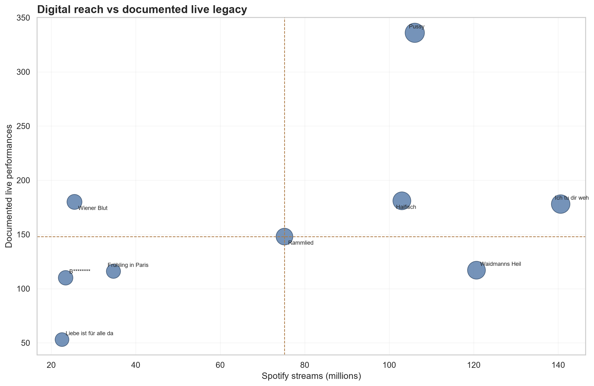
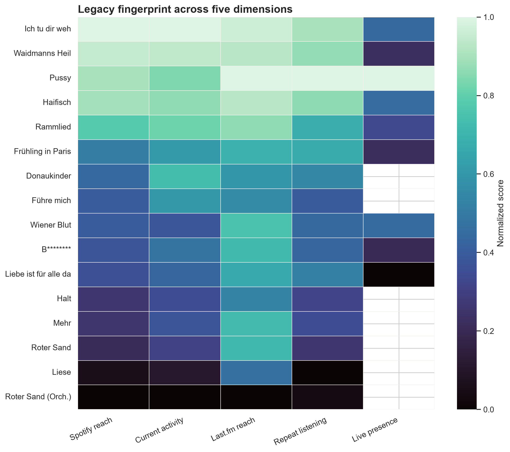
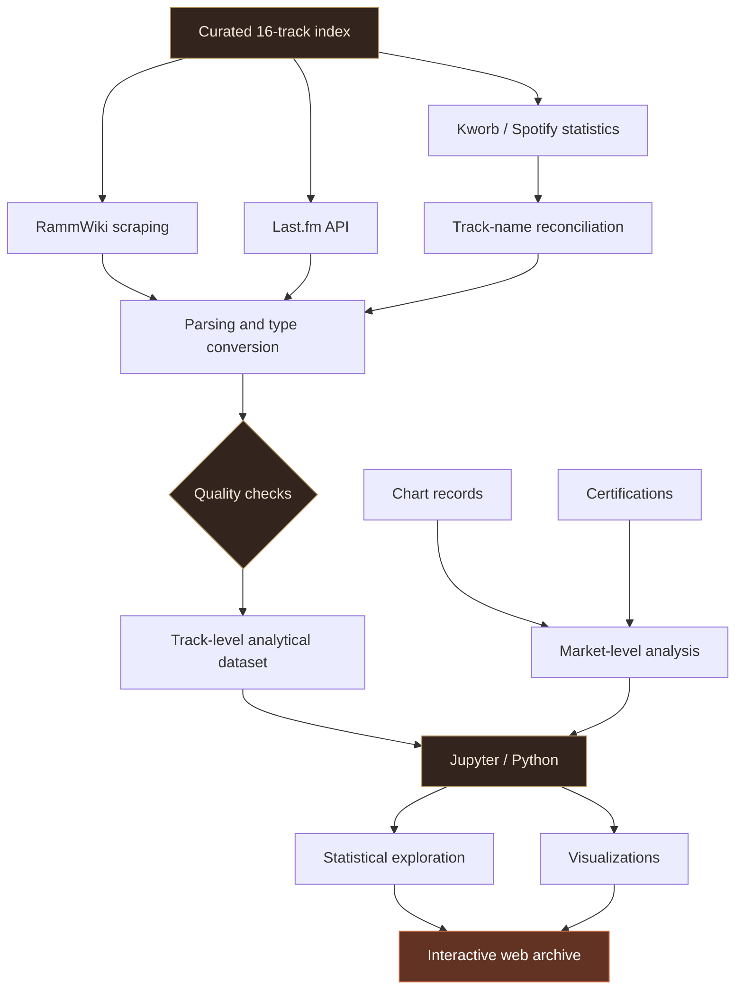

<div align="center">

# LIFAD
### FROM RELEASE TO LEGACY

**RAMMSTEIN · LIEBE IST FÜR ALLE DA · 2009—2026**

*An independent investigation into the commercial, digital, and live afterlife of a single album.*

---

**16 TRACKS** &nbsp; / &nbsp; **18 CHART RECORDS** &nbsp; / &nbsp; **13 CERTIFICATION RECORDS**

**PYTHON** · **PANDAS** · **DATA COLLECTION** · **EXPLORATORY ANALYSIS** · **INTERACTIVE WEB**

</div>

<br>

> **The research question**
>
> Seventeen years after its release, what does the success of *Liebe ist für alle da* actually look like — and does the answer change depending on where we look?

## 00 / THE RECORD

Released on **16 October 2009**, Rammstein's sixth studio album, *Liebe ist für alle da*, occupies an unusual place in the band's catalogue. Its title translates to *Love Is There for Everyone*, though the material itself is far less reassuring: uncomfortable narratives, provocation, dark humour, violence, vulnerability, and musical contrasts that refuse a straightforward interpretation.

I chose this album partly because I knew the material well. That familiarity became useful domain knowledge when identifying alternate versions, interpreting track histories, and deciding which comparisons would make sense.

But musical familiarity alone was not enough.

I wanted to understand how the album's sixteen tracks had developed different identities across international charts, streaming services, listener behaviour, and documented live performances.

**LIFAD: From Release to Legacy** is the result: a Python-based, multi-source analytical study presented alongside an interactive digital archive.

---

## 01 / THE EVIDENCE

<div align="center">

| 771.9M | 31.1M | 83 WEEKS | 336 |
|:---:|:---:|:---:|:---:|
| Spotify streams | Last.fm scrobbles | Germany chart run | Pussy live performances |

<sub>Compiled from project datasets. Streaming and Last.fm figures are snapshots from September 2026, not live counters. Last.fm totals represent summed track-level scrobbles.</sub>

</div>

### One album. Several definitions of success.

The analysis produced some particularly revealing contrasts:

**47.6% of Spotify streams come from just three tracks.**

*Ich tu dir weh*, *Waidmanns Heil*, and *Pussy* account for almost half of the album's accumulated Spotify activity. The top five tracks account for approximately 70.7%.

**Lifetime popularity and current momentum are different measures.**

*Donaukinder* leads the album in daily Spotify activity relative to accumulated streams, recording approximately **433 daily streams per million total streams** in the collected snapshot.

**Spotify and Last.fm do not always rank the tracks identically.**

*Mehr*, for example, occupies 13th place by Spotify streams but 7th by Last.fm listeners within the sixteen-track dataset.

**The stage tells another story.**

*Pussy* leads the documented live records with 336 performances. *Wiener Blut*, meanwhile, has 180 documented performances despite a considerably smaller Spotify footprint than the album's biggest digital tracks.

None of these observations establishes an objectively superior song. They demonstrate why a single popularity ranking cannot adequately describe an album's long-term presence.

---

## 02 / VISUAL EVIDENCE

### I. The concentration problem

How much of the album's streaming footprint belongs to a small number of tracks?


The Pareto view combines individual Spotify streams with cumulative share, exposing the concentration that a simple album-wide total would conceal.

### II. Two platforms, different hierarchies

Absolute Spotify streams and Last.fm listeners are not directly comparable units. Their **within-album rankings**, however, can be compared.


The resulting rank shifts help identify songs whose positions differ across platforms.

### III. What the stage remembers



This analysis places Spotify scale alongside documented live performance counts. Only tracks with available live records appear in this particular comparison.

### IV. A five-dimensional legacy



The final legacy fingerprint examines:

- Spotify reach
- Current streaming activity
- Last.fm audience reach
- Repeat-listening intensity
- Documented live presence

Missing live records remain missing rather than being assigned an artificial score of zero.

**[Explore the complete visualization archive →](visuals/)**

---

## 03 / BUILDING THE DATASET

### The project did not start with a ready-made dataset.

This was my first end-to-end experience building an analytical dataset from multiple external sources.

I began by defining the album's sixteen distinct track records, including the eleven Standard Edition tracks and five Special Edition tracks. This curated index became the reference for subsequent data collection and matching.

The resulting workflow combined four sources:

| Source | Data collected | Purpose |
|---|---|---|
| **RammWiki** | Track metadata, BPM, key, duration, working titles, live history, identifiers | Musical and archival context |
| **Last.fm API** | Listeners, scrobbles, track identifiers | Audience reach and repeat listening |
| **Kworb** | Spotify cumulative and daily streams | Digital scale and current activity |
| **Chart and certification sources** | Peak positions, chart duration, certification records | Commercial history |

### Collection pipeline



### Technical decisions that mattered

**01 — Parsing semi-structured pages**

I used `requests` and BeautifulSoup to extract labelled fields from RammWiki song pages, followed by numeric and date conversions in pandas.

**02 — Reconciling different naming conventions**

Alternate recordings did not always have identical names across sources.

One example was the orchestral version of *Roter Sand*:

```python
df_tracks.loc[
    df_tracks["track_name"] == "Roter Sand (Orchester Version)",
    "spotify_lookup_name"
] = "Roter Sand - Orchester Version"
```

Its duration and recording identifiers also required separate handling to preserve the distinction from the original track.

**03 — Enriching the data through an API**

Last.fm's `track.getInfo` endpoint supplied track-level listeners and playcount figures. From those fields, I calculated an engagement indicator:

```python
df_tracks["scrobbles_per_listener"] = (
    df_tracks["lastfm_playcount"]
    / df_tracks["lastfm_listeners"]
).round(2)
```

This ratio describes repeat-listening intensity within the Last.fm data; it is not a measure of unique album listeners.

**04 — Retrieving Spotify figures**

Because cumulative per-track streams were not available through the public Spotify API endpoints used for this project, I parsed Kworb's artist-level table using `pandas.read_html`, selected the relevant columns, standardized numeric values, and reconciled track titles.

**05 — Validating the final dataset**

The collection pipeline checks the expected record count, duplicated track names, and missing critical values after enrichment.

It also preserves collection timestamps and source references.

[Read the data collection script →](lifad_data_collection.py)

---

## 04 / THE ANALYTICAL WORK

### Eighteen questions. Multiple perspectives.

The Jupyter notebook moves through the album's history without assuming that one measurement should dominate the others.

| Analytical direction | Central question |
|---|---|
| Chart performance | Does reaching No. 1 imply a longer chart life? |
| Commercial geography | How widely did the album succeed? |
| Streaming concentration | Is the catalogue dependent on a few tracks? |
| Cross-platform behaviour | Do Spotify and Last.fm agree? |
| Engagement | Which songs attract more repeat listening? |
| Current momentum | Which recordings are unusually active relative to their accumulated streams? |
| Live history | Does stage prominence align with digital reach? |
| Editions | How do Standard and Special Edition tracks differ? |
| Musical attributes | Are tempo and duration associated with audience behaviour? |
| Legacy modelling | How much do the results depend on analytical weighting? |

### Beyond rankings

The notebook uses:

`Pareto analysis` · `Spearman rank correlation` · `Log transformations` · `Residual analysis` · `Min–max normalization` · `Multi-dimensional profiling` · `Weight sensitivity checks`

For the final comparison, I constructed a legacy profile across five dimensions. I also tested balanced, digital-heavy, and live-heavy weighting schemes to examine how the resulting rankings changed.

These scores are **analytical constructs**, not objective measures of artistic value.

[Open the complete analysis notebook →](lifad%20deep%20analysis.ipynb)

---

## 05 / WHAT THE DATA COULD NOT TELL ME

A significant part of this project involved deciding where the evidence stopped.

**Missing live records are not zero performances.**

Seven of the sixteen tracks lack documented live counts in the collected data. Assigning zero would introduce a claim the source does not establish. Live-specific comparisons therefore exclude those missing records.

**Certification figures cannot simply be added together.**

European certifications overlap with national markets, while different awarding bodies may report sales, shipments, or sales-plus-streaming figures. The project keeps those distinctions intact.

**The dataset is small by design.**

Sixteen tracks allow close inspection but not strong statistical generalization. Correlations describe relationships within this particular catalogue; they do not establish causation.

**The streaming figures are snapshots.**

Current daily activity and accumulated totals cannot reconstruct every year of listening behaviour between 2009 and 2026.

These constraints influence the interpretation, rather than appearing as an afterthought.

---

## 06 / FROM NOTEBOOK TO ARCHIVE

### Analysis should be possible to explore without opening Python.

The Jupyter notebook contains the detailed calculations and validation steps. The accompanying web presentation translates selected findings into a different format: a dark, industrial digital archive inspired by the album's visual atmosphere.

The website includes:

- Album overview and edition structure
- International chart performance
- Certification records
- Spotify and Last.fm indicators
- Documented live history
- Interactive sixteen-track explorer
- Historical context and source references
- A release-to-legacy overview

Each track has its own dossier with musical metadata, listening figures, live information, and an archival note.

**Built with HTML, CSS, and vanilla JavaScript.**

The website does not require an API key or backend to display its curated content.

[Explore the website source →](web/index.html)

### Running the website locally

From the repository root:

```bash
cd web
python -m http.server 8000
```

Then open:

`http://localhost:8000`

---

## 07 / REPOSITORY MAP

```text
LIFAD/
│
├── lifad_data_collection.py
│   └── Multi-source data collection and enrichment
│
├── lifad_tracks_new.csv
│   └── 16-track metadata, Spotify, Last.fm and live records
│
├── lifad_charts.csv
│   └── International chart history
│
├── lifad_certifications.csv
│   └── Certification records and reporting bases
│
├── lifad deep analysis.ipynb
│   └── 18 analytical questions, calculations and visualizations
│
├── visuals/
│   └── Exported analytical figures
│
└── web/
    ├── index.html
    ├── style.css
    └── script.js
```

### Reproducing the analysis

```bash
git clone https://github.com/normanland/LIFAD.git
cd LIFAD

pip install pandas numpy matplotlib seaborn requests beautifulsoup4 lxml notebook

jupyter notebook "lifad deep analysis.ipynb"
```

The supplied CSV files allow the analysis to run without recollecting external data.

The collection script is a separate workflow. It prompts for a Last.fm API key and currently uses a configured local output directory, which should be adjusted if data collection is repeated elsewhere.

---

## 08 / SOURCES & DEVELOPMENT

**Primary data and reference material**

- [RammWiki](https://ramm.wiki/) — track histories and metadata
- [Last.fm API](https://www.last.fm/api) — listening statistics
- [Kworb](https://kworb.net/spotify/) — Spotify track statistics
- International chart and certification sources linked in the respective datasets

**Development environment**

Python · Jupyter · pandas · NumPy · requests · BeautifulSoup · Matplotlib · Seaborn · HTML · CSS · JavaScript · Git

AI-assisted tools were used during frontend prototyping and development. Data interpretation and methodological decisions are documented through the project notebooks and source code.

---

<div align="center">

### 09 / THE AFTERLIFE

*The album was released once. Its history has been recorded in many different places.*

This project follows those records — from the original commercial release to the catalogue's digital and live presence seventeen years later.

**16 OCTOBER 2009 — 16 OCTOBER 2026**

**LIFAD: FROM RELEASE TO LEGACY**

---

Independent research and portfolio project. Not affiliated with or endorsed by Rammstein.

[BACK TO TOP ↑](#lifad)

</div>
